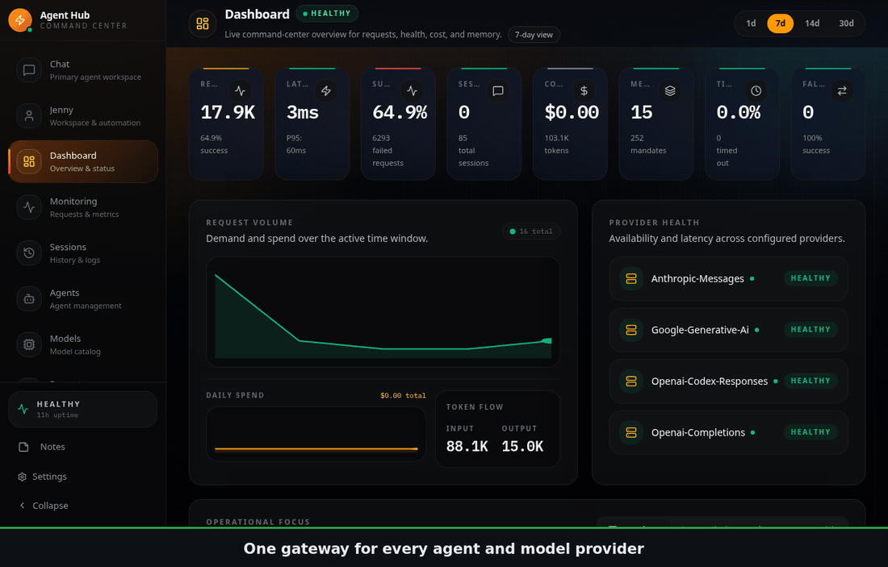

# Agent Hub

Agent Hub is a self-hosted control plane for developers and operators running AI agents across providers. It combines routing, persistent memory, sessions, tools, access control, and request telemetry so agents can be operated through one API and dashboard.



*The animation shows the dashboard as it looked in June 2026, before the October 2026 UI redesign.*

## What it does

- Routes completions and SSE streams through a model catalog, per-agent fallbacks, circuit breakers, and provider health checks.
- Stores semantic memory, session history/branches, named agents, and versioned prompts. Memory episodes can be archived (kept but never injected) and restored.
- Runs an agentic tool loop with server-side tools (shell, files, code search, web research) that can delegate work to other agents as child sessions, plus a committee roundtable that combines several agents' views on one question.
- Governs context from one place: a single selector and renderer decide which prompts and memory reach Claude Code, Codex, Pi, Google's Antigravity CLI, MCP clients and internal agents, with exact previews, revision-checked saves, and undo ([details](docs/architecture/context-governance.md)).
- Accounts for cost: metered spend, subscription plans (Claude/Codex plan cost, limits, Codex credits, API-equivalent value), and an idempotent ingest endpoint (`POST /api/analytics/costs/ingest`) for model calls that external clients paid for outside Agent Hub.
- Enforces per-project daily/monthly cost budgets and per-agent request and token limits.
- Exposes cost/latency/request dashboards, permissions and audit context, image adapters, and a Python SDK.

## Current scope

The repository contains the FastAPI backend, Next.js dashboard, SDKs, shared UI packages, and Hatchet workflows. Configured cloud providers and local OpenAI-compatible endpoints can serve workloads. Anthropic/Claude is catalogued for reference and excluded from workload routing by design; Claude Code instead runs as an external worker that launches the official CLI on the operator's own subscription login, and Agent Hub ingests its transcript.

Provider keys are optional for local UI/API smoke use. Provider completions and optional web, browser, and voice features need their own configuration and should report unavailable capabilities clearly.

## Getting started

The bundled development stack requires Docker Engine and Compose v2:

```bash
git clone https://github.com/elias-leslie/agent-hub.git
cd agent-hub
cp .env.example .env
```

Generate the database password, encryption key, client secret, and internal-service secret using the [project guide](docs/project-guide.md#quickstart-bundled-docker-stack), then run:

```bash
./scripts/generate-hatchet-dev-token.sh .env
docker compose --env-file .env up -d --build
```

Open <http://localhost:3003>; the backend health endpoint is <http://localhost:8003/health>. For Docker, leave native database/Redis/test URL overrides blank so Compose can supply container service addresses. The guide also covers native development.

## Runtime, data, and integrations

Native development needs Python 3.13+, Node.js 20+, pnpm 10+, PostgreSQL with pgvector support, Redis, and Hatchet. PostgreSQL holds memory, sessions, prompts, and operational records; Redis and Hatchet support caching and workflow execution. Provider selection belongs to Agent Hub rather than calling applications.

Before exposing the service beyond loopback, configure strong client/internal secrets and network or reverse-proxy access controls. Empty provider keys do not enable provider calls. Screenshots and published evidence must exclude tokens, private sessions, personal data, and customer content.

## Development and verification

`st` is the author's workspace tool; it wraps the standard checks. Contributors can run them directly:

```bash
cd backend && uv run ruff check . && uv run ty check app && uv run pytest
pnpm --filter frontend lint && pnpm --filter frontend exec vitest run
```

[The project guide](docs/project-guide.md#testing-linting-type-checks-and-build) retains exact backend Ruff/Ty/pytest/build and frontend lint/TypeScript/Vitest/build commands, dependency setup, and running-app smoke checks. [CONTRIBUTING.md](CONTRIBUTING.md) describes contributions; runtime evidence is separate from compilation.

## Documentation

- [Project guide](docs/project-guide.md) for capabilities, configuration, SDK use, and verification.
- [Python SDK](packages/agent-hub-client/README.md) and [examples](examples/README.md).
- [Context delivery](integrations/context-delivery/README.md) and [context governance](docs/architecture/context-governance.md).
- [Security reporting](SECURITY.md), [Apache 2.0 license](LICENSE), and [notice](NOTICE).
